# Architektur

MASCHERA ist ein lokaler Python-Dienst mit einer Weboberfläche ohne
Fremdbibliotheken. Das eigene Fenster, der Browser und der Serverbetrieb zeigen
dieselbe Oberfläche und sprechen denselben Dienst an.

## Komponenten

```mermaid
flowchart TB
  subgraph hülle[Hülle]
    F["Eigenes Fenster<br>app/fenster.py, pywebview"]
    B["Browser<br>app/app.py"]
    W["Serverbetrieb<br>app/wsgi.py, Docker"]
  end
  UI["Oberfläche<br>app/static: index.html, maschera.css,<br>maschera.js, seiten.js"]
  API["Flask-Kern<br>app/serve.py"]
  subgraph kette[Kette in core/]
    D["Datei lesen<br>tools/dokumente.py"]
    R["Stufe 1 und 2<br>recognizers.py, detectors.py"]
    M["Stufe 3 Modell<br>inference.py"]
    U["Eigene Regeln<br>user_rules.py"]
    G["Zusammenführen<br>inference.merge"]
    K["Maskieren und Wörterbuch<br>masking.py"]
  end
  P["Country Pack<br>packs/ch"]
  E["Einstellungen des Anwenders<br>Regeln, Vorlieben, Vorlagen"]
  H["Modellgewichte<br>runs/ oder Datenordner"]
  F --> UI
  B --> UI
  W --> UI
  UI -->|"nur /api/*"| API
  API --> D --> G
  API --> R --> G
  API --> M --> G
  API --> U --> G
  G --> K
  R --> P
  M --> P
  K --> P
  M --> H
  API <-->|"nur auf ausdrücklichen Befehl"| E
```



Die Oberfläche erkennt nichts selbst. Sie liest, zeigt und kopiert; jede
Erkennung läuft im Dienst. Aus dem Dienst führt kein Weg zu einem Sprachmodell:
Der Text verlässt MASCHERA nur über die Zwischenablage des Anwenders.

## Exakte Regeln der Kette

Die Reihenfolge in `filter_text`: Regeln erkennen, Modell, `merge`, `mask`.

**Fenster.** 512 Token, davon 510 nutzbar (Sondertoken je Fenster), Überlappung 128,
Schritt 382. Die Abschneidung des Tokenizers ist aus. Liegt ein Token in zwei Fenstern,
gewinnt die Vorhersage mit der höheren Sicherheit. Das Vertrauen einer Spanne ist das
Minimum über alle Token, die sie überschneiden, nicht nur die enthaltenen.

**`merge`, in dieser Folge:**

1. Modelltreffer unter der Schwelle ihres Tags fallen weg. Ein Tag ohne Schwelle läuft
   durch.
2. Modellspannen werden auf Wortgrenzen ausgedehnt, nie verworfen, höchstens 50 Zeichen
   je Seite. Wortzeichen sind Buchstaben, Ziffern, `_`, `'` und `’`.
3. Muster laufen, eigene Regeln kommen gleichrangig dazu.
4. Ein Modelltreffer auf einem Stufe-1-Tag ohne gültige Prüfsumme fällt weg.
5. Alle Spannen werden sortiert und der Reihe nach behalten, wenn ihre Stelle frei ist.
   Sortiert wird nach: Stufe 1 zuerst, alle anderen gleich; dann längere Spanne zuerst;
   dann Quelle (Muster und Regel vor Modell).

Die Länge steht vor der Quelle: Sonst schlüge ein kurzer Mustertreffer eine längere,
richtige Modellspanne, und ein Rest bliebe im Klartext.

**`mask`, in dieser Folge:**

1. Überlappungen auflösen, Vorrang: Stufe 1, 2, 3, dann Länge. Unbekannte Tags zählen
   als Stufe 9.
2. Propagation, dann erneut Überlappungen auflösen.
3. Nur Tags mit Aktion `mask` werden ersetzt. `ohne` und Vorlieben setzen Tags auf
   `tag_only`.
4. Gruppen bilden nach (Tag, kanonischer Wert), in der Reihenfolge des ersten Auftretens.
5. Je Tag zählt eine Nummer ab 1. Der kanonische Wert bekommt die Basisnummer, weitere
   Formen derselben Gruppe `a`, `b` und so weiter: `[FULLNAME_1]`, `[FULLNAME_1a]`.
6. Ersetzt wird von hinten nach vorne.

Ohne Wörterbuch läuft alles gleich, nur das Wörterbuch bleibt leer. Die Nummern sagen
weiter, dass zwei Stellen dieselbe Person sind.

**Propagation.** Sie gilt für `FULLNAME`, `GIVENNAME`, `ORG`, `HEALTHCARE_ORG` und
`STREET`, ohne Schwelle: Jede Spanne, die `merge` behalten hat, zählt. `BUILDINGNUM`
bewusst nicht, «12» sammelte jede 12 ein.

1. Der ganze Wert wird an Wortgrenzen gesucht, gross und klein genau, Leerraum im Wert
   passt auf beliebigen Leerraum, also auch auf Zeilenumbrüche.
2. Danach werden bei `FULLNAME`, `ORG` und `HEALTHCARE_ORG` die Teile gesucht, getrennt an
   Leerraum und Bindestrich, nur bei mehrteiligen Werten, ab 3 Zeichen und mit grossem
   Anfang. Das nackte «Meier» wird so Variante von «Hans Meier».
3. Belegte Stellen bleiben, wie sie sind. Bei zwei Personen mit gleichem Nachnamen fällt
   ein nackter Nachname an die erste.

**Rückwandlung.** Ein Regex-Durchgang über den Text, deshalb spielt die Reihenfolge von
`[X_1]` und `[X_1a]` keine Rolle. Unbekannte Platzhalter bleiben stehen und kommen nach
`nicht_gefunden`. Unterscheidet sich einer nur in Gross- und Kleinschreibung, steht er
dort **und** bekommt den Hinweis `schreibweise`, ersetzt wird er nicht. Die Oberfläche
nimmt vorher im Browser die Markdown-Entwertung `\[FULLNAME\_2\]` zurück, nur innerhalb
von Platzhaltern. Das ist Dekodieren, nicht Raten. Ein fett gesetzter Platzhalter
`**[FULLNAME_1]**` wird normal ersetzt, die Sternchen bleiben.

## Module

| Ort | Aufgabe |
|---|---|
| `core/recognizers.py`, `core/detectors.py` | Stufe 1 und 2: Muster, Anker, Prüfsummen, Erkenner ohne Regex |
| `core/inference.py` | Fenster über lange Texte, Modellläufer (torch, ONNX), `merge`, `filter_text` |
| `core/masking.py` | Überlappungen, Propagation, Platzhalter, Wörterbuch, `restore` |
| `core/user_rules.py` | Eigene Regeln des Anwenders |
| `core/vorlieben.py`, `core/vorlagen.py`, `core/einstellungen.py` | Die drei übrigen Einstellungsdateien |
| `core/pfade.py` | Ablageorte für Einstellungen, Modell, Gold |
| `core/modell.py` | Modell finden und auf Befehl holen, Prüfsummen |
| `core/neueste.py` | «Nach Updates suchen», nur auf Klick |
| `core/hinweise.py` | Hinweise mit Schlüssel, damit sie übersetzbar bleiben |
| `core/einmalig.py`, `core/prozess.py`, `core/ausgabe.py`, `core/symbol.py` | Betrieb des Fensters: nur ein Prozess, Prozessname, Ausgabe, Symbol |
| `core/injector.py`, `core/alignment.py`, `core/evaluate.py` | Trainingsdaten, Ausrichtung auf BIO, Auswertung |
| `app/serve.py` | Alle Endpunkte, Wirtsprüfung, Content Security Policy |
| `app/app.py` | Liefert die Oberfläche aus und stellt das Thema ein |
| `app/fenster.py` | Fenster, Tray, Erststart, Portwahl, Neustart |
| `app/wsgi.py` | Einstieg für einen richtigen WSGI-Server |
| `app/static/` | Oberfläche, Schriften, Willkommensbilder |
| `packs/ch/` | Alles Länderspezifische als Daten |
| `tools/` | Trainingsdaten, Messung, Gold, Pakete, Release |

## Architekturprinzipien

1. **Erkennen und Maskieren sind zwei Achsen.** Ein Tag kann erkannt werden,
   ohne ersetzt zu werden. Die Maskierungspolitik liegt in `ACTION_MAP`
   (Daten), nicht in den Trainingsdaten, änderbar ohne Neutraining.
2. **Prüfsummen schlagen das Modell**, aber nur wo sie mathematisch
   beweisend sind.
3. **Das neuronale Modell ist die Recall-Engine, die Regex die
   Precision-Garantie.**
4. **Alles Länderspezifische ist Daten, kein Code** (siehe Country Pack unten).
5. **Das Modell ist notwendig.** `--ohne-modell` ist eine Messhilfe, kein
   Betriebszustand: ohne Modell bleibt jeder Name im Klartext.

## Die Kette: drei Stufen und eine Zusammenführung

| Stufe | was sie tut | wer entscheidet |
|---|---|---|
| **1, Prüfsummen** | AHV, UID, IBAN, QR, Luhn, GLN | die Mathematik, kompromisslos |
| **2, Muster** | Regexe mit viersprachigen Kontextankern | der Anker, nicht die Form allein |
| **3, Modell** | ein feinabgestimmtes mmBERT je Pack | die Konfidenz gegen eine Schwelle |
| **merge** | führt die drei zusammen, löst Überlappungen | Stufe 1 schlägt 2 schlägt 3 |

Drei Eigenschaften dieser Anordnung sind wichtig und nicht offensichtlich:

**Stufe 2 kann hinzufügen, nicht verbieten.** Ein Muster, das schweigt,
verhindert nichts, das Modell liefert dieselbe Spanne trotzdem. Wer eine
Erkennung *unterdrücken* will, muss das im Training tun oder in `merge`, und
`merge` ist der empfindlichste Teil der Kette.

**Das Modell ist notwendig, nicht optional.** `--ohne-modell` ist kein
Betriebszustand. Ohne Stufe 3 leckt jeder Personenname, den kein Muster
kennt, und Personennamen sind bewusst *kein* Stufe-2-Muster, weil ein
Muster für «Grossbuchstabe, dann Kleinbuchstaben» in einem deutschen Text
jedes Substantiv trifft.

**Dokument-Propagation ist der grösste Recall-Gewinn im System.** Sobald ein
String irgendwo mit hoher Konfidenz als `FULLNAME` erkannt wurde, wird jedes
weitere Vorkommen desselben Strings maskiert, auch das nackte «Meier» im
Verteiler, in der Tabelle, im Unterschriftenblock. Anreden (`Herr`, `Frau`,
`Monsieur`, `Avv.`) sind dabei **Merkmal, nicht Label**: sie werden auf `O`
trainiert, weil in einem echten Dokument der Name viermal steht und die
Anrede einmal.

**Lange Dokumente werden ganz gesehen.** Das Modell liest in Fenstern von
512 Token mit Überlappung. Beide Läufer, torch für Messungen, ONNX als
Alternative, müssen die Abschneidung des Tokenizers abschalten, sonst sieht
das Modell nur den Kopf. `tests/test_langes_dokument.py` baut dafür ein
Dokument, das lang genug ist.

## Country Pack

```
packs/
└─ ch/
   ├─ pack.yaml            Manifest: Version, Sprachen, Backbone, Labelvertrag
   ├─ taxonomy.yaml        45 Tags: Stufe, Aktion, Budget, BIO-Index, Schwellen
   ├─ patterns.yaml        Regex + Kontextanker, viersprachig
   ├─ macros.yaml          Expansionen + Kopplungsregeln
   ├─ bezeichnungen.yaml   Tagnamen in vier Sprachen
   ├─ modell.json          woher das Modell kommt, Grösse, Prüfsummen
   ├─ validators/          Prüfsummen
   ├─ generators/          Identifikatoren
   ├─ nomenclatures/
   │  ├─ build.py          raw → normalisiert, reproduzierbar
   │  ├─ raw/              (nicht im Repository) Downloads
   │  └─ dist/             (nicht im Repository)
   ├─ templates/           de/ fr/ it/ en/
   ├─ eval/                nur Wegweiser; das Testset liegt ausserhalb
   └─ adapter.py
```

### Adapter-Interface

```python
def get_tags()          -> tuple[Tag, ...]      # in der eingefrorenen Reihenfolge
def get_labels()        -> tuple[str, ...]      # BIO-Liste, stabile Reihenfolge
def get_label_hash()    -> str                  # Fingerabdruck des Labelvertrags
def get_bezeichnungen(sprache) -> dict[str, str]
def get_actions()       -> dict[str, str]       # mask | tag_only
def get_thresholds()    -> dict[str, float]     # aus Budget, Ausnahmen je Tag
def get_placeholders()  -> dict[str, str]
def validate()          -> list[str]            # Befunde, leer = in Ordnung
```

### Drei Fallen

1. **Labelreihenfolge einfrieren.** Die BIO-Indexreihenfolge ist Vertrag.
   Neue Tags **anhängen, nie einfügen**, sonst passen alte Checkpoints
   stillschweigend nicht mehr. Reihenfolge explizit in `taxonomy.yaml`.
2. **Checkpoint kennt den Pack.** In jedem Modellordner: Pack-Version und
   Hash der Labelliste, beim Laden geprüft. Ohne das lädt man irgendwann ein
   Modell mit falschem Mapping und bekommt plausibel aussehenden Unsinn,
   nichts stürzt ab.
3. **Nomenklaturen nicht ins Repository.** `build.py` erzeugt sie
   reproduzierbar; verteilt wird der Bauplan, nicht die Daten.
