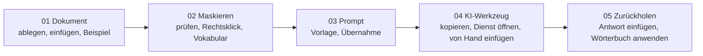
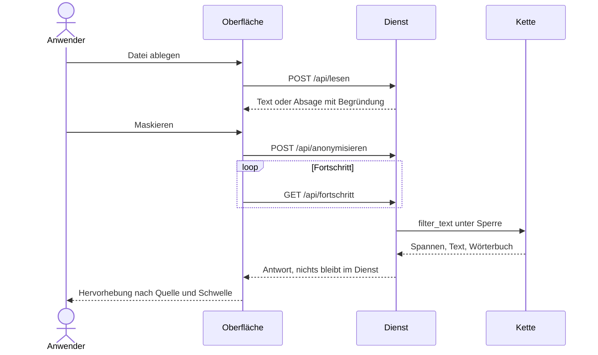
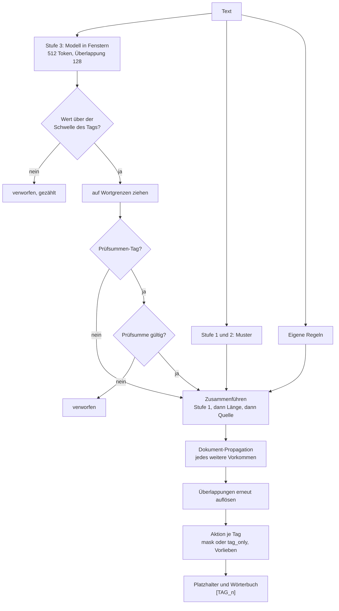
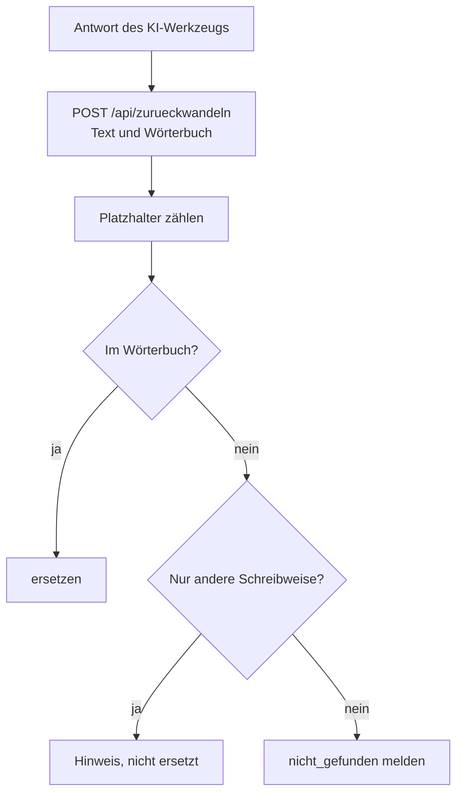
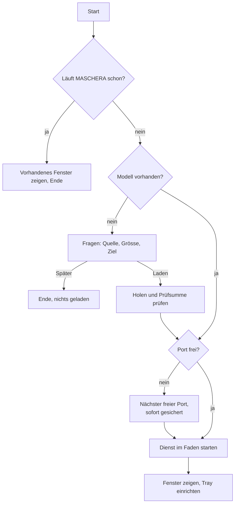
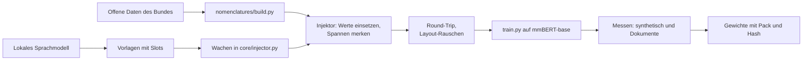
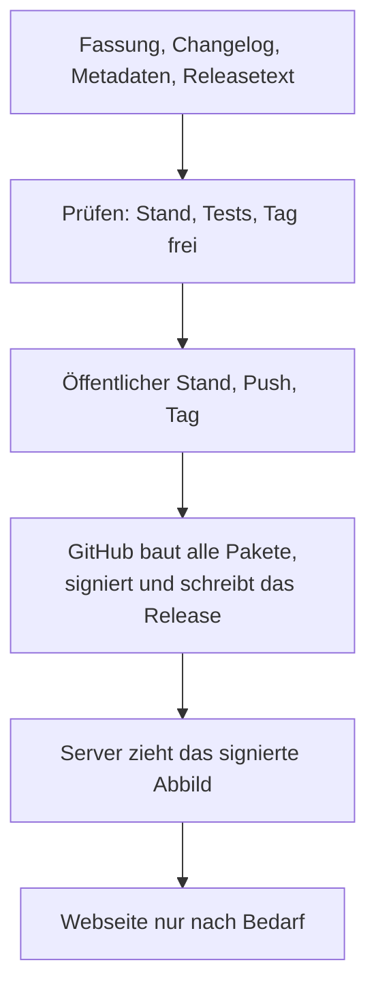

# Abläufe

## Arbeitsweg des Anwenders

Die fünf Schritte sind zugleich die Tab-Reihenfolge der Oberfläche
([10 Oberfläche](10_oberflaeche.md)).

## Maskieren

Ablegen liest nur. Maskieren ist eine Handlung mit eigenem Knopf, weil sie eine
Entscheidung ist. Das Wörterbuch lebt allein im Browser des Anwenders.

## Die Kette

## Zurückholen

Was nicht zugeordnet werden kann, ist der wichtigste Teil der Antwort: Ein
Sprachmodell schreibt Platzhalter um, und ein still stehen gebliebener
`[FULLNAME_1]` im Brief darf nicht unbemerkt bleiben.

## Start des eigenen Fensters

## Modell entstehen lassen

## Release

Einzelheiten stehen in [12 Pakete und Release](12_pakete_release.md).
