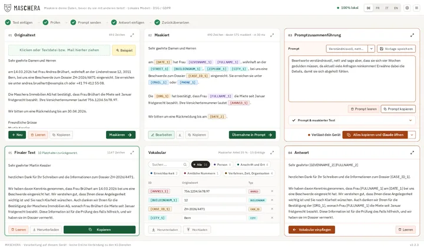
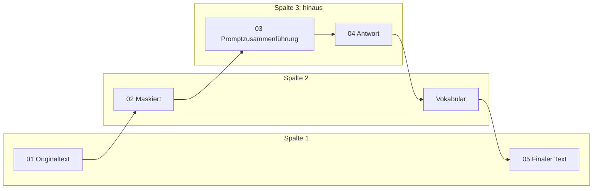

# Oberfläche

Eine Seite, keine Fremdbibliotheken: `index.html`, `maschera.css`, `maschera.js`
und `seiten.js`. Alle Kennungen stehen in [elemente.md](erzeugt/elemente.md),
alle Beschriftungen in [texte.md](erzeugt/texte.md), Hilfe und Willkommen in
[seiten.md](erzeugt/seiten.md).

## Aufbau

Oben stehen Kopfzeile und Schrittleiste, unten eine Fusszeile mit Fassung und
Status. Nur 03 und 04 betreffen, was das Gerät verlässt. 05 steht unter 01: Dort
kommt der Fluss zurück.

## Kopfzeile

- Wortmarke MAS**CH**ERA mit Maske und Spruch. Ein Klick wirkt wie «Neu».
- Plakette «100% lokal», auf einem Server «Speichert nichts» mit Erklärung.
- Sprachwahl DE, FR, IT, EN. Bei wenig Platz eine Auswahlliste.
- Zahnrad für die Einstellungen, Burgermenü.
- In einer Testfassung «TEST» in der Mitte und gelber Grund.

Wird es eng, fällt zuerst die Plakette, dann der Spruch, dann wird die Sprachwahl
zur Auswahlliste, zuletzt fällt der Schriftzug.

## Schrittleiste

Fünf Schritte, abgeleitet aus dem Arbeitsstand: nichts maskiert 0, maskiert 1,
übernommen 2, Antwort da 3, finaler Text 5. Ein Klick springt zur Kachel und
zeigt sie kurz umrandet. Passt die Leiste nicht, rollt sie seitlich mit dem
aktuellen Schritt in der Mitte.

## Kacheln

Jede Kachel hat einen Kopf mit Nummer, Titel, Meldung, Zahl und Vergrössern, einen
Rumpf und einen Fuss mit Hauptknopf und Nebenknöpfen. Vergrössern legt die Kachel
über die Seite; Escape, derselbe Knopf oder ein Klick daneben bringen sie zurück.

| Kachel | Inhalt | Hauptknopf |
|---|---|---|
| 01 Originaltext | Ablage, Beispiel, Warnungen, Textfeld | Maskieren, dazu Neu |
| 02 Maskiert | Hinweise, Laufbalken, Text mit Platzhaltern, Bearbeiten als Textfeld | Übernahme in Prompt |
| Vokabular | Suche, Legende und Gruppenfilter, Liste, Herunterladen, Hochladen | keiner |
| 03 Promptzusammenführung | Vorlagenwahl, Speichern, Prompt, aufklappbar «Prompt & maskierter Text», Warnung zur Zone | Alles kopieren und … öffnen, Dienstmenü daneben |
| 04 Antwort | Textfeld, Einfügen, Leeren | Vokabular einpflegen |
| 05 Finaler Text | Offene Platzhalter, Text | Kopieren |

### 01 Originaltext

- Datei wählen oder ablegen: `.pdf`, `.docx`, `.txt`, `.md`, `.log`, `.csv`,
  `.json`, `.eml`, `.msg`, `.mbox`. Die Ablage ist mit der Tastatur erreichbar,
  Enter oder Leertaste öffnet die Dateiwahl.
- Zieht man eine Datei über das Fenster, wächst die grosse Ablagefläche über die
  Kachel. Sie bleibt offen, bis die Datei abgelegt ist oder das Fenster verlässt.
- Was sich nicht als Datei ablegen lässt, meldet sich in vier Sprachen.
- Ein PDF mit Brotli-Kompression wird mit Begründung abgewiesen ([EN-033](15_entscheide.md)).
- «Beispiel» lädt einen erfundenen Text. Beim ersten Start leuchtet der Knopf.
- Ablegen liest nur. Maskiert wird erst auf den Knopf.

### 02 Maskiert

- Jede Fundstelle ist eine Plakette mit Gruppenfarbe. Die Quelle zeigt ihr Rand,
  siehe [11 Design](11_design.md).
- Im Klartext gelassene Stellen haben einen hellgrauen Rahmen. So sieht man, dass
  sie erkannt wurden.
- Der Tooltip nennt den Originalwert, wodurch maskiert wurde und die Sicherheit
  des Modells in Prozent.
- **Rechtsklick auf eine Plakette oder ein Wort:** Das Menü mit Suche zeigt zuerst
  die häufigsten Tags, dann Gruppen, die einzeln auf- und zugehen. Es springt dabei
  nicht. Man kann Tag wechseln, Maskierung entfernen oder ein Wort maskieren.
  `CANTON` ist eine eigene Gruppe «nur erkannt».
- Ein Laufbalken zeigt den gemessenen Fortschritt, keine Schätzung.
- Hinweise stehen hinter dem Info-Knopf.

### Vokabular

Ist immer an. Jede Zeile zeigt Platzhalter und Wert, ein rotes × nimmt den
Platzhalter im ganzen Dokument zurück. Es lässt sich als Datei im Browser
herunterladen und wieder einlesen; der Dienst sieht diese Datei nie.

### 03 Promptzusammenführung

- Vorlagenmenü mit Filter, Speichern als eigene Vorlage.
- «Übernahme in Prompt» zeigt einen leeren Kreis, dreht kurz, dann steht ein Haken.
- Der Sendeknopf kopiert Prompt und maskierten Text und öffnet den Dienst. Der
  Text wird nicht gesendet, er liegt in der Zwischenablage.
- Dienste stehen alphabetisch: ChatGPT, Claude, Copilot, Gemini, Mistral. Eigene
  Dienste kommen in den Einstellungen dazu, höchstens 20.
- Unter macOS und Windows öffnet der Klick einen echten Verweis im selben Zug, weil
  `window.open` dort die Nutzergeste verliert. Im Fenster geht er in den
  Standardbrowser.

### 04 Antwort und 05 Finaler Text

- Einpflegen zeigt, was geschieht: Erst leuchtet das Vokabular auf, dann der
  finale Text.
- Bleiben Platzhalter stehen, meldet 05 das. Der Hinweis lässt sich schliessen und
  kommt beim nächsten Einpflegen wieder, wenn erneut etwas übrig bleibt.

## Dialoge

| Dialog | Inhalt |
|---|---|
| Einstellungen | Suche, dann Darstellung, Schriftart, Allgemein (nur Fenster), Server (nur Fenster), Dienste, Klartext-Tags, Eigene Regeln. Fuss mit Abbrechen und «Speichern & schliessen» |
| Hilfe, Impressum | Aus `seiten.js`, ohne Nachladen |
| Willkommen | Fünf Seiten und Schluss, Punkte, Zurück, Weiter, Sprachwahl, «Nicht mehr anzeigen» |
| Frage | Eigener Dialog, nie `window.confirm` |

Regeln für alle Dialoge:

- Sie schliessen nur, wenn man auf dem Hintergrund drückt **und** dort loslässt.
  Text markieren über den Rand hinaus schliesst nichts.
- Escape und ein Klick daneben brechen ab. Abbrechen nimmt Dienste, Adresse, Farben
  und Schrift zurück.
- Ein Fehler beim Speichern steht beim Abschnitt, zu dem er gehört. Der Dialog
  rollt hin, das Feld ist rot umrandet.
- Eine leere Dienstzeile fällt still weg. Ohne jeden Dienst wird nicht gespeichert.

### Einstellungen im Einzelnen

| Abschnitt | Felder |
|---|---|
| Darstellung | Farben: Automatisch, Hell, Dunkel |
| Schriftart | Familie (IBM Plex, Serifen, Feste Breite), Grösse 70 bis 140 %, Vorschau |
| Allgemein | Beim Schliessen in den Tray statt beenden, schmales Fenster immer im Vordergrund |
| Server | Adresse und Port, Prüfknopf |
| Dienste | Name und Adresse je Zeile, Vorgaben wiederherstellen |
| Klartext-Tags | Tags, die erkannt, aber nicht ersetzt werden |
| Eigene Regeln | YAML mit Prüfung und Speichern |

## Burgermenü

In dieser Reihenfolge: Willkommen, Hilfe, Fehler melden, Kontakt, maschera.ch,
Herunterladen, Nach Updates suchen, Quellcode auf GitHub, Impressum, Im Browser öffnen. Die Liste steht in
`app/static/adressen.json`. Hilfe, Impressum und Willkommen liegen im Paket.

## Tastatur

- **Tab** folgt dem Arbeitsweg `ARBEITSWEG` in `maschera.js`, in dieser Folge:
  `orig`, `knopf-maskieren`, `maskiert` oder im Bearbeiten `maskiert-feld`,
  `knopf-uebernahme`, `knopf-vorlagen`, `prompt`, `knopf-senden`, `antwort04`,
  `knopf-einpflegen04`, `final`, `knopf-final-kopieren`, dann `knopf-neu`, gestapelt
  `knopf-neu-unten`. «Neu» steht in 01, kommt aber zuletzt.
- Ein Element zählt nur, wenn es nicht deaktiviert, nicht verborgen, ohne negativen
  `tabIndex` und sichtbar ist. Geprüft wird bei jedem Tab neu, ein eben deaktiviertes
  Element fällt also einfach heraus.
- **Shift-Tab** geht denselben Weg zurück.
- **Von einem Nebenknopf aus** (etwa nach einem Klick) geht es dort weiter, wo er in
  seiner Kachel steht. Der Rang der Kachel ist 01=1, 02 und Vokabular=2, 03=3, 04=4,
  05=5, Neu=6, darin zählt die Stellung im Quelltext.
- **Am Ende** springt Tab in die Fusszeile oder, wenn dort nichts bedienbar ist, zum
  ersten Element der Kopfzeile. Shift-Tab am Anfang springt zum letzten Element der
  Kopfzeile. Vom letzten Element der Kopfzeile führt Tab auf den Anfang des Wegs, vom
  ersten der Fusszeile führt Shift-Tab auf sein Ende.
- In einem offenen Vorlagen- oder Dienstmenü gilt der normale Weg des Menüs. Mit Strg,
  Alt oder Meta bleibt Tab unberührt.
- **Pfeil links und rechts** erreichen die übrigen Knöpfe, Suchfelder und die Ablage
  einer Kachel, sobald ein Knopf oder die Ablage den Fokus hat. Die Gruppe läuft im
  Kreis in Quelltextfolge. 02 und das Vokabular sind eine Gruppe. In einem Suchfeld
  bewegen die Pfeile die Einfügemarke und springen erst am Textrand weiter, in
  Textfeldern gar nicht. Einstieg ist deshalb der Hauptknopf der Kachel.
- **Escape** schliesst Menüs, Dialoge und die vergrösserte Kachel.
- **Pfeile im Willkommen** blättern.
- **F5 und Strg-R** fragen im eigenen Dialog nach, solange ein Wörterbuch besteht.

Die Fokusfolge prüft `T-OBERFLAECHE-94` mit einer Attrappe, die den Fokus mitschreibt.

## Ansichten nach Breite

| Ansicht | Bedingung |
|---|---|
| Drei Spalten | ab 81.25em Breite und 44em Höhe |
| Gestapelt | darunter, Schrittleiste rollt |
| Schmal | unter 40em, Knöpfe im Fuss wachsen |
| Seitenleiste | Fenstermodus `widget`: schmal, einspaltig, immer im Vordergrund, Breite 410 px (378 Inhalt, 32 Rahmen) |

## Betriebsarten

| | Eigenes Fenster | Browser | Server |
|---|---|---|---|
| Plakette | 100% lokal | 100% lokal | Speichert nichts |
| Einstellungen Allgemein, Server | ja | nein | nein |
| Tray und Seitenleiste | ja | nein | nein |
| Marken | Einstellungen | `localStorage` | `localStorage` |
| Update-Suche | über den Dienst | über den Dienst | meldet den Weg zur Download-Seite |

## Zustände

- Ohne Modell: Warnung, Hauptknöpfe entsprechend gekennzeichnet.
- Startbild, bis `/api/zustand` antwortet.
- Leerer Befund: Fehler mit Begründung, nie «nichts gefunden».
- «Neu» und «Beispiel» setzen auch Rubriken, Suchwörter, Filter, vergrösserte Kachel
  und aufgeklappte Teile zurück.
- `prefers-reduced-motion` schaltet Bewegung ab.
