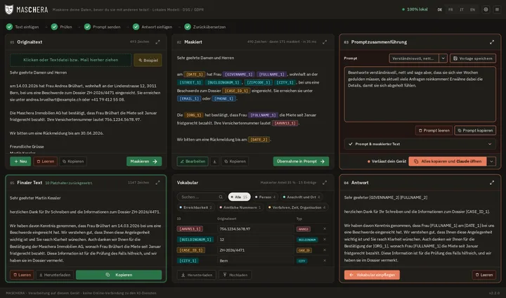

# Design

Alle Werte stehen in [design.md](erzeugt/design.md). Dieses Kapitel sagt, was sie
bedeuten.

## Sprache der Farbe

| Farbe | Bedeutung |
|---|---|
| Grün (Ton 155) | Bleibt auf dem Gerät: Hauptknöpfe, Akzent, Fokus |
| Rot (Ton 38 bis 45) | Geht hinaus: Spalte 03 und 04, Sendeknopf |
| Gelb | Knopf «Beispiel» und Kopf der Testfassung |
| Warmes Neutral (Ton 85) | Flächen und Text |

Alle Farben sind in OKLCH auf einer gemeinsamen Helligkeitsskala erzeugt, damit
dieselbe Stufe jeder Rolle gleich hell wirkt. In der roten Spalte ist die Schrift
schwarz, Deaktiviertes dunkelgrau.

## Plaketten

Die Fläche folgt der Gruppe des Tags, der Rand der Quelle:

| Quelle | Rand |
|---|---|
| Modell, Propagation | keiner |
| Von Hand | 3 px doppelt |
| Prüfsumme | 1 px gestrichelt, matt grün |
| Muster | 1 px gestrichelt |
| Eigene Regel | 1 px gepunktet |

Gruppen: Person, Herkunft, Anschrift, Erreichbar, Amtlich, Finanzen, Gesundheit,
Verfahren, nur erkannt (`TAG_GRUPPEN` in `maschera.js`).

## Schrift

| Rolle | Schrift |
|---|---|
| Wortmarke | Barlow Condensed |
| Oberfläche, Titel | IBM Plex Sans |
| Mono | IBM Plex Mono |
| Dokumenttext | wählbar: IBM Plex, Serifen, Feste Breite |

Die Schriften liegen in `app/static/schriften/` als WOFF2 mit OFL-Lizenz. Die
Wortmarke wechselt die Schrift nie mit der Wahl des Anwenders.

## Masse

- Alle Grössen in `rem`, gebunden an `--skala` (70 bis 140 %). Feste Pixel nur für
  Kanten bis 2 px.
- Abstände `--space-1` bis `--space-4`, Stufe 0.2125rem.
- Rundungen: Karte 12 px, Feld 8 px, Pille 6 px, klein 4 px. Mehr gibt es nicht.
- Drei Schattenstufen.

## Thema

Drei Stufen: Automatisch folgt `prefers-color-scheme`, Hell und Dunkel gelten
ausdrücklich. Das gewählte Thema steht schon beim ersten Zeichnen im `<html>`, damit
nichts aufblitzt. Die Maske hat im dunklen Thema einen hellen Saum, das Programmsymbol
trägt einen schmalen hellen Rand.

## Zeichen

Jede Bedienung trägt ein Zeichen, gezeichnet als SVG-Pfad mit `currentColor`, 2 px
Strich, runde Enden. Die Pfade stehen in `index.html` und in `MENUEBILDER`,
`KNOPFBILDER` und `SINNBILDER` in `maschera.js`. Die Maske ist eine Datei
(`maske.svg`) für Kopf und Startbild. Das Programmsymbol macht `core/symbol.py`
quadratisch, damit es in der Leiste nicht verzogen wird.

## Bewegung

Kurze Übergänge, zum Beispiel Schieben im Willkommen und Aufleuchten beim
Einpflegen. Ein waagrechter Rollbalken darf nie entstehen.
