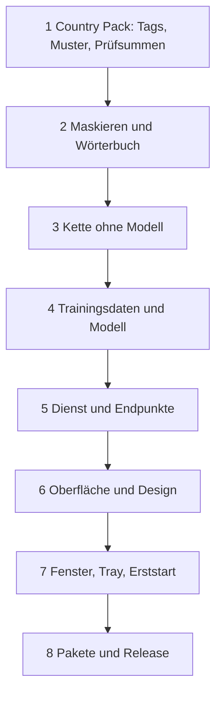

# Neubau

So baut jemand MASCHERA aus diesem Katalog neu auf. Massgeblich sind die Kapitel, die
Prüfungen im [Testkatalog](erzeugt/testkatalog.md) sagen, wann ein Schritt fertig ist.

## Was von aussen nötig ist

| Was | Woher |
|---|---|
| Backbone | `jhu-clsp/mmBERT-base` auf Hugging Face |
| Nomenklaturen | Offene Daten von BFS, swisstopo, BJ, Zefix über LINDAS, siehe [08](08_synthese_training.md). `packs/ch/nomenclatures/build.py` nennt die Quellen |
| Vorlagen | Liegen in `packs/ch/templates/`, neu über ein lokales, OpenAI-kompatibles Sprachmodell |
| Modell | Fertig: `packs/ch/modell.json`. Neu: GPU ab Ampere, rund 72 Minuten für 3 Epochen |
| Golddokumente | Eigene Dokumente, nie im Repository, siehe [09](09_evaluation.md) |
| Schriften | IBM Plex, Barlow Condensed, OFL, `app/static/schriften/HERKUNFT.md` |
| Laufzeit | Python 3.13, node für die Oberflächenprüfung, [Paketlisten](erzeugt/abhaengigkeiten.md) |

## Reihenfolge

| Schritt | Lesen | Fertig, wenn grün |
|---|---|---|
| 1 | [06 Erkennung](06_erkennung.md), [tags](erzeugt/tags.md), [Muster](erzeugt/erkennungsregeln.md) | `T-LABELVERTRAG-EINGEFROREN-1`, `T-CH-CHECKSUMS-1`, `T-PATTERNS-1` |
| 2 | [04 Architektur](04_architektur.md) | `T-MASKING-1`, `T-MASKING-2` |
| 3 | [05 Abläufe](05_ablaeufe.md) | `T-INFERENCE-2`, `T-INFERENCE-5` |
| 4 | [08 Synthese und Training](08_synthese_training.md), [09 Evaluation](09_evaluation.md) | `T-INJECTOR-2`, `T-ALIGNMENT-7`, `T-EVALUATE-2` |
| 5 | [07 API](07_api.md), [13 Sicherheit](13_sicherheit.md) | `T-API-3`, `T-API-10`, `T-APP-21` |
| 6 | [10 Oberfläche](10_oberflaeche.md), [11 Design](11_design.md), [texte](erzeugt/texte.md), [design](erzeugt/design.md) | `T-OBERFLAECHE-1`, `T-OBERFLAECHE-94` |
| 7 | [02 Funktional](02_funktional.md) | `T-FENSTER-1`, `T-FENSTER-19`, `T-MODELL-2` |
| 8 | [12 Pakete und Release](12_pakete_release.md) | `T-FENSTER-12`, `T-FENSTER-32` |

## Was nicht gleich herauskommt

- **Die Gewichte:** Ein neues Training liefert ein anderes Modell, siehe
  [Was ein Neulauf liefert](08_synthese_training.md). Für dasselbe Verhalten
  übernimmt man `ch-v63b`.
- **Die Golddaten:** Sie sind nicht öffentlich, eigene Messwerte weichen ab.
- **Das Aussehen im Detail:** Die Werte stehen im Katalog. Wer gleich aussehen will,
  nimmt `app/static/` als Vorlage.
